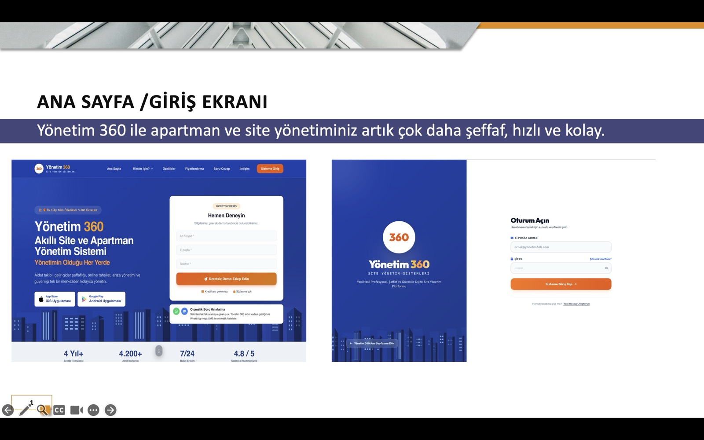
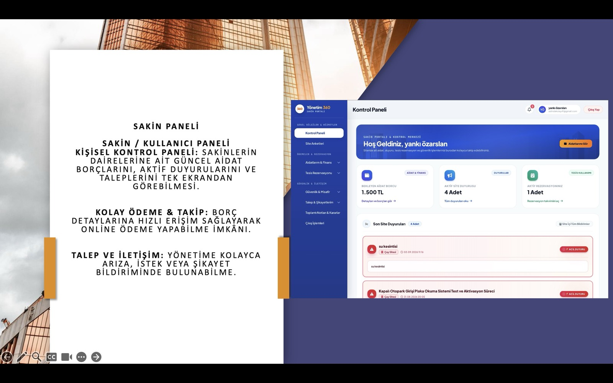
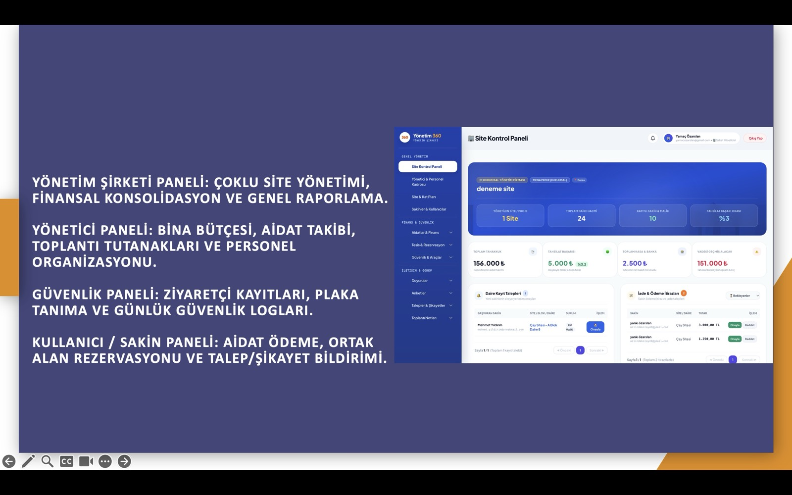
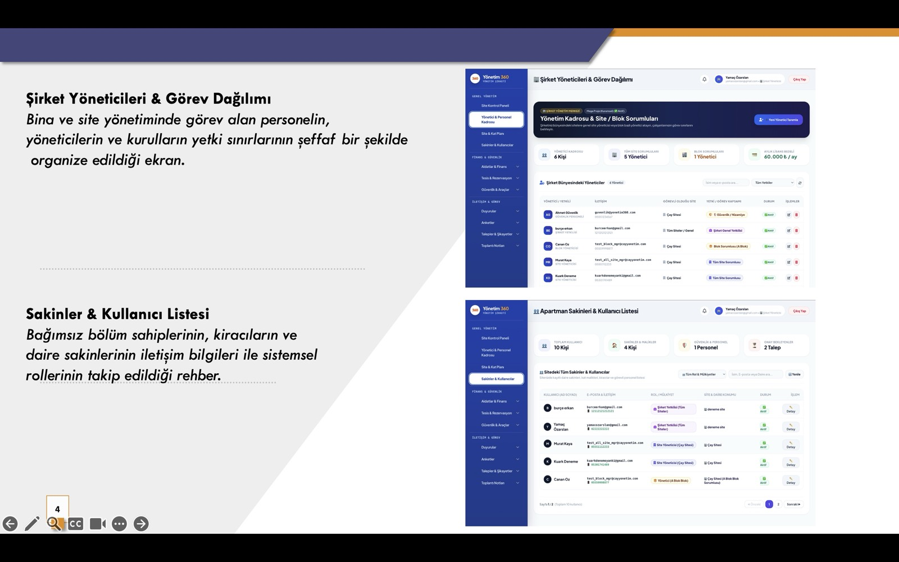
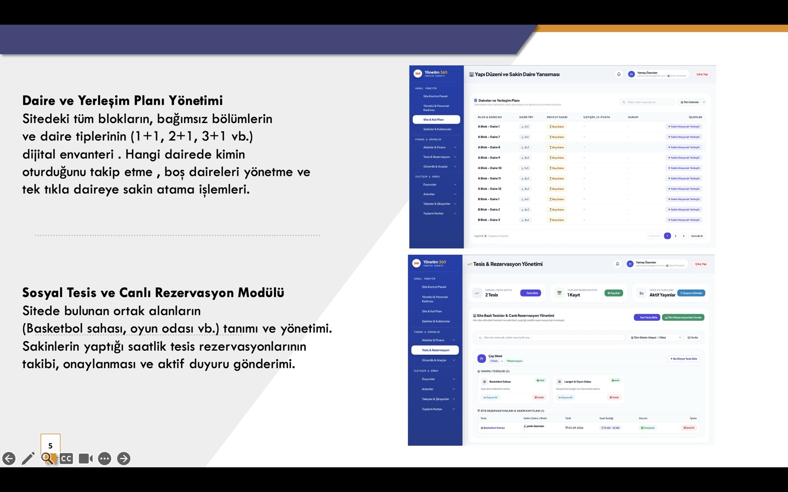
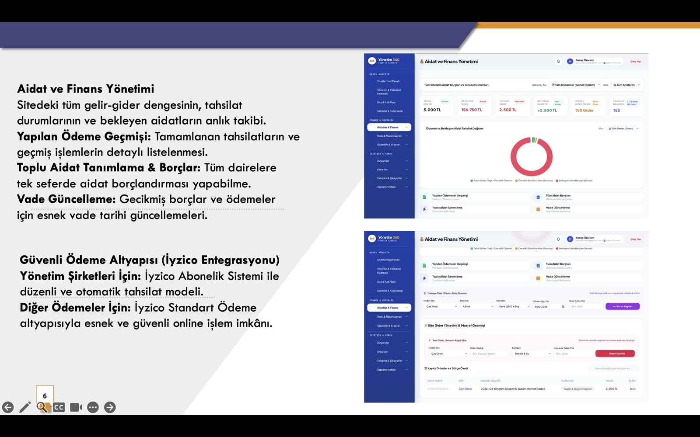
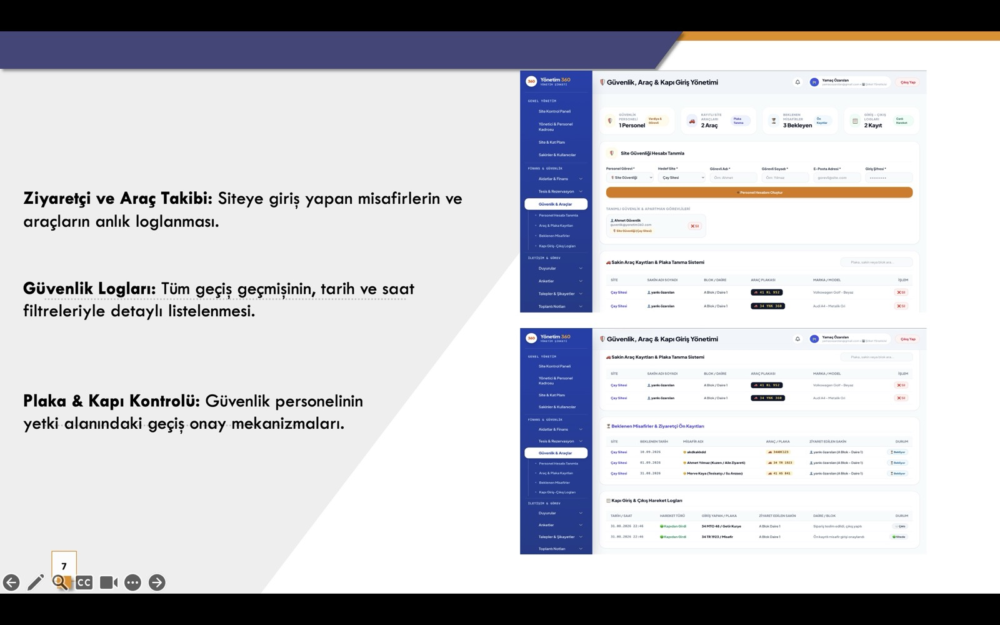
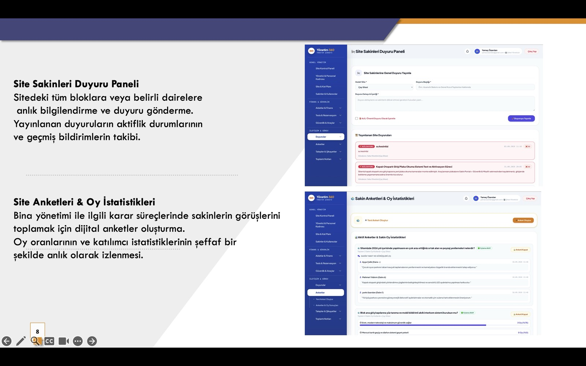
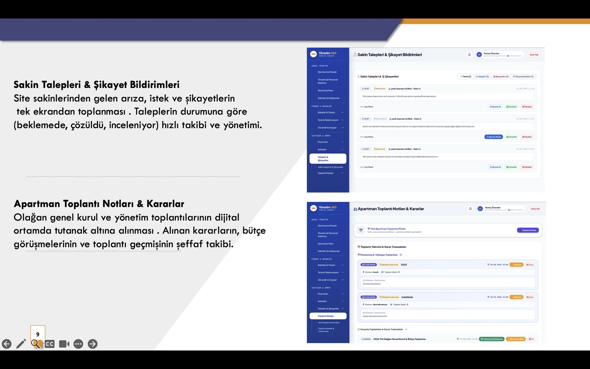
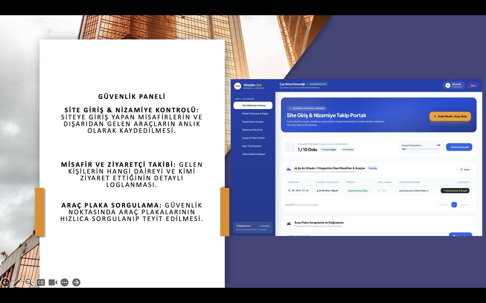

<div align="center">

# Site 360 - Site Yonetim Sistemi

**Modern, guvenli ve tam ozellikli site ve apartman yonetim platformu**

[](https://python.org)
[](https://flask.palletsprojects.com)
[](https://postgresql.org)
[](https://iyzico.com)
[](https://tailwindcss.com)

</div>

---

## Ekran Goruntuleri

### Ana Sayfa ve Giris Ekrani



### Sakin Kontrol Paneli



### Yonetim Sirketi Paneli



### Yoneticiler ve Sakinler Listesi



### Daire Yerlesim ve Tesis Rezervasyon



### Aidat ve Finans Yonetimi



### Guvenlik, Arac ve Kapi Giris Yonetimi



### Duyuru Paneli ve Site Anketleri



### Talep/Sikayet ve Toplanti Notlari



### Guvenlik Paneli



---

## Ozellikler

### 6 Farkli Kullanici Rolu

| Rol | Yetkiler |
|-----|----------|
| **Sistem Admini** | Tum sirket, site ve kullanici yonetimi |
| **Yonetim Sirketi** | Portfolyo yonetimi, paket ve abonelik |
| **Site Yoneticisi** | Aidat, daire, duyuru, anket, raporlama |
| **Site Sakini** | Online odeme, borc sorgulama, talep |
| **Guvenlik** | Ziyaretci kayit ve cikis kontrolu |
| **Personel** | Bakim-onarim ve gorev takibi |

### Online Odeme - iyzico

- 3D Secure ve 256-Bit SSL
- Otomatik dijital makbuz
- Gecikme zammi hesaplama
- Itiraz ve iade sistemi

### Finansal Yonetim

- Aidat ve ortak gider tahakkuku
- Borc takip ve yaslandirma raporu
- Toplu SMS/e-posta hatirlatma
- Gelir-gider raporlama

### Guvenlik ve Hukuki Uyum

- JWT tabanli oturum yonetimi
- KVKK uyumlu aydinlatma metni
- Mesafeli Satis Sozlesmesi
- Hesap silme ve veri anonimlestime

### Yapi ve Tesis Yonetimi

- Blok, daire, ortak alan tanimlama
- Ortak alan rezervasyonu
- Toplanti ve anket modulu
- Duyuru ve bildirim sistemi

---

## Teknoloji Yigini

| Katman | Teknoloji |
|--------|-----------|
| Backend | Python 3.12, Flask, Flask-JWT-Extended |
| Veritabani | PostgreSQL 16, SQLAlchemy, Alembic |
| Frontend | TailwindCSS, Vanilla JS, Font Awesome |
| Odeme | iyzico Checkout Form |
| E-Posta | Gmail SMTP |
| Konteyner | Docker Compose |

---

## Proje Yapisi

```
Site360/
|-- app.py                  # Ana uygulama
|-- config.py               # Yapilandirma
|-- models.py               # Veritabani modelleri
|-- extensions.py           # Flask eklentileri
|-- decorators.py           # Rol yetkilendirme
|-- routes/
|   |-- auth_routes.py      # Giris ve kayit
|   |-- admin_routes.py     # Admin islemleri
|   |-- company_routes.py   # Yonetim sirketi
|   |-- finance_routes.py   # Finansal islemler
|   |-- payment_routes.py   # iyzico odeme
|   |-- security_routes.py  # Guvenlik modulu
|   |-- structure_routes.py # Yapi yonetimi
|   |-- ticket_routes.py    # Talep ve sikayet
|   |-- poll_routes.py      # Anketler
|   |-- meeting_routes.py   # Toplantilar
|   |-- reservation_routes.py # Rezervasyonlar
|   |-- announcement_routes.py # Duyurular
|   |-- staff_routes.py     # Personel
|   +-- pages_routes.py     # Statik sayfalar
|-- services/
|   |-- iyzico_subscription_service.py  # Abonelik
|   |-- email_service.py    # E-posta
|   +-- cms_service.py      # Icerik yonetimi
|-- templates/              # HTML sablonlari
|-- static/                 # CSS, JS, gorseller
|-- migrations/             # Veritabani migration
|-- docker-compose.yml
|-- requirements.txt
+-- .env.example
```

---

## Kurulum

### Gereksinimler

- Python 3.12+
- Docker ve Docker Compose

### 1. Repoyu Klonla

```bash
git clone https://github.com/YankiOzarslan/Site360.git
cd Site360
```

### 2. Sanal Ortam ve Bagimliliklar

```bash
python -m venv venv
source venv/bin/activate
pip install -r requirements.txt
```

### 3. Ortam Degiskenleri

```bash
cp .env.example .env
# .env dosyasini duzenleyin
```

### 4. Veritabani ve Calistirma

```bash
docker-compose up -d
flask db upgrade
python app.py
```

Uygulama: `http://localhost:5001`

---

## iyzico Test Kartlari

| Kart No | SKT | CVV | Sonuc |
|---------|-----|-----|-------|
| `5528790000000008` | 12/30 | 123 | Basarili |
| `5400010000000004` | 12/30 | 123 | Basarili |
| `4766620000000001` | 12/30 | 123 | Basarili |

---

## Lisans

MIT - 2025

---

<div align="center">
  <sub>Site 360 ile site yonetimi dijitallesiyor</sub>
</div>
